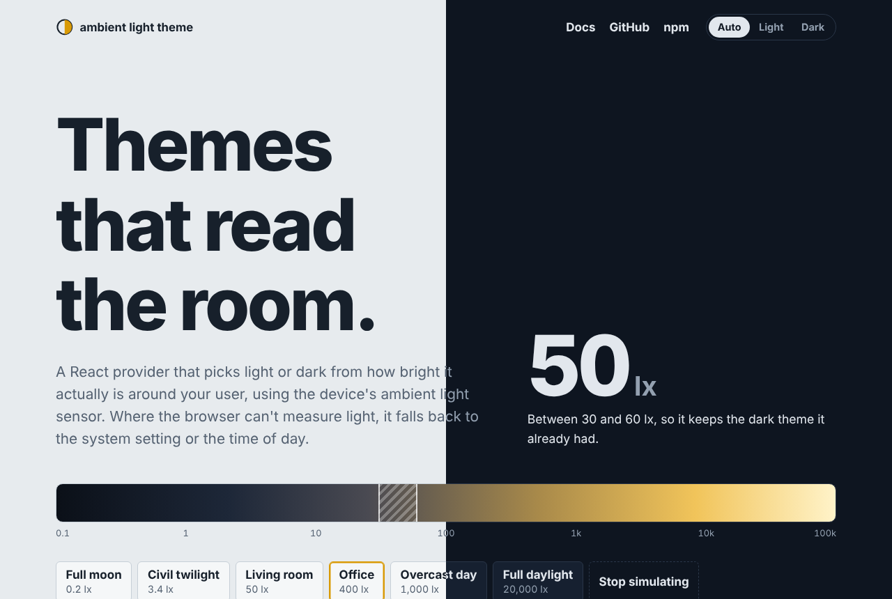

# react-ambient-light-adaptive-theme

[](https://www.npmjs.com/package/react-ambient-light-adaptive-theme)
[](https://github.com/chandana-galgali/react-ambient-light-adaptive-theme/actions/workflows/ci.yml)
[](LICENSE)

A React provider that switches between light and dark themes based on how bright it actually is around your user. It reads the device's ambient light sensor, and falls back to the system setting or the time of day when the browser can't measure light.

**[Try the live demo →](https://chandana-galgali.github.io/react-ambient-light-adaptive-theme/)** Drag a lux needle from moonlight to full daylight and watch the page switch.

[](https://chandana-galgali.github.io/react-ambient-light-adaptive-theme/)

## Features

- **Reads real light levels** through the [`AmbientLightSensor`](https://w3c.github.io/ambient-light/) API, including the permission check.
- **No flicker.** Two thresholds (dark below 30 lx, light above 60 lx) with a hold zone between them, and a short switch delay so a hand passing over the sensor doesn't flip the theme.
- **Fallbacks that stay live:** the system preference (updates when the OS switches), the time of day (checked every minute), or a fixed theme.
- **Manual override** (`auto` / `light` / `dark`) that's remembered between visits.
- **No flash on load.** An optional inline script sets the theme before the first paint in server-rendered apps.
- **Works anywhere you can render React**: Next.js App Router (server components), Vite, CRA. Ships ESM, CommonJS and TypeScript types. The only dependency is React itself, as a peer dependency.

## Installation

```bash
npm install react-ambient-light-adaptive-theme
```

## Quick start

### Next.js (App Router)

```tsx
// app/layout.tsx
import { AmbientLightThemeProvider } from "react-ambient-light-adaptive-theme";
import { AmbientThemeScript } from "react-ambient-light-adaptive-theme/script";

export default function RootLayout({ children }: { children: React.ReactNode }) {
  return (
    <html lang="en" suppressHydrationWarning>
      <head>
        <AmbientThemeScript />
      </head>
      <body>
        <AmbientLightThemeProvider>{children}</AmbientLightThemeProvider>
      </body>
    </html>
  );
}
```

If you pass options to the provider, give the same `fallback`, `attribute`, `storageKey`, `nightStart` and `nightEnd` to `<AmbientThemeScript>` so the first paint matches.

### Plain React (Vite, CRA)

```tsx
import AmbientLightThemeProvider from "react-ambient-light-adaptive-theme";

createRoot(document.getElementById("root")!).render(
  <AmbientLightThemeProvider fallback="time-based">
    <App />
  </AmbientLightThemeProvider>,
);
```

### Style both themes

The provider adds `light` or `dark` to `<html>` and sets `color-scheme`, so native scrollbars and form controls match.

```css
:root,
.light {
  --background: #ffffff;
  --foreground: #171717;
}

.dark {
  --background: #0f1622;
  --foreground: #e3e8ee;
}

body {
  background: var(--background);
  color: var(--foreground);
}
```

With **Tailwind CSS v4**, make the `dark:` variant follow the class:

```css
@custom-variant dark (&:where(.dark, .dark *));
```

Prefer a data attribute? Use `attribute="data-theme"` and style `[data-theme="dark"]`.

### Read the theme in a component

```tsx
import { useAmbientTheme } from "react-ambient-light-adaptive-theme";

function ThemeBadge() {
  const { theme, source, illuminance, mode, setMode } = useAmbientTheme();

  return (
    <button onClick={() => setMode(mode === "auto" ? "dark" : "auto")}>
      {theme} theme from {source}
      {illuminance !== null && ` (${Math.round(illuminance)} lx)`}
    </button>
  );
}
```

## How it decides

1. If the user picked **light** or **dark** manually, use that.
2. Otherwise, if the sensor has a reading: below `darkThreshold` → dark, above `lightThreshold` → light, in between → keep the current theme. A change only happens once the sensor has pointed to it for `switchDelay` ms.
3. Otherwise, use the `fallback`: the system setting, the time of day, or a fixed theme.

## API

### `<AmbientLightThemeProvider>`

| Prop | Type | Default | Description |
| --- | --- | --- | --- |
| `fallback` | `"system" \| "time-based" \| "light" \| "dark"` | `"system"` | What to use when there's no light reading. |
| `darkThreshold` | `number` | `30` | Go dark below this many lux. |
| `lightThreshold` | `number` | `60` | Go light above this many lux. Between the two, the theme doesn't change. |
| `switchDelay` | `number` | `1000` | Milliseconds the sensor must keep pointing to the other theme before switching. Simulated readings switch immediately. |
| `frequency` | `number` | `1` | Sensor readings per second. |
| `nightStart` | `number` | `19` | Hour (0–23) the time-based fallback turns dark. |
| `nightEnd` | `number` | `7` | Hour it turns light again. Windows may wrap past midnight. |
| `attribute` | `"class" \| "data-*" \| null` | `"class"` | Where to write the theme on `<html>`. `null` leaves the DOM alone. |
| `storageKey` | `string \| null` | `"ambient-theme-mode"` | localStorage key for the manual choice. `null` to not remember it. |
| `defaultMode` | `"auto" \| "light" \| "dark"` | `"auto"` | Mode before the user picks one. |
| `disableSensor` | `boolean` | `false` | Skip the sensor and use only the fallback. |
| `simulatedIlluminance` | `number \| null` | `null` | Feed a lux value yourself (demos, tests, Storybook). |
| `onThemeChange` | `(theme, source) => void` | None | Called when the theme or its source changes. |

### `useAmbientTheme()`

| Value | Type | Description |
| --- | --- | --- |
| `theme` | `"light" \| "dark"` | The theme in use. |
| `isDarkMode` | `boolean` | `theme === "dark"`. |
| `source` | `"sensor" \| "simulated" \| "system" \| "time" \| "static" \| "manual"` | Why this theme was picked. |
| `illuminance` | `number \| null` | Latest reading in lux. |
| `sensorStatus` | `"idle" \| "unsupported" \| "pending" \| "active" \| "denied" \| "error" \| "simulated"` | What the sensor is doing. |
| `mode` | `"auto" \| "light" \| "dark"` | Auto, or the user's manual choice. |
| `setMode` | `(mode) => void` | Change the mode. Saved to `storageKey`. |
| `toggleTheme` | `() => void` | Switch to the opposite theme as a manual choice. |

`useTheme` still works as an alias for code written against 0.1.x.

### Helpers

These are exported for custom setups and tests:

| Export | Description |
| --- | --- |
| `classifyIlluminance(lux, previous, dark?, light?)` | The threshold-with-hold-zone rule. |
| `createSwitchGate(onSwitch, getDelay?)` | The switch-delay logic, for use with your own sensor code. |
| `isNightHour(hour, start?, end?)`, `themeFromTime(date, start?, end?)` | The time-based rule. |
| `isAmbientLightSensorSupported()` | Feature check, safe during SSR. |
| `queryAmbientLightPermission()` | Resolves to `"granted"`, `"denied"` or `"prompt"`. |
| `startAmbientLightSensor({ frequency, onReading, onError })` | Start the sensor; returns a stop function. |
| `getThemeScript(options)` | The no-flash script as a string, for frameworks that inject scripts their own way. |
| `DEFAULTS` | The default option values. |

## Browser support

`AmbientLightSensor` is part of the experimental Generic Sensor API. It's off by default everywhere, and it needs HTTPS.

| Where | Real sensor? |
| --- | --- |
| Chrome / Edge on Android | Yes, after turning on `chrome://flags/#enable-generic-sensor-extra-classes` |
| Chrome / Edge on a laptop with a light sensor (most with auto-brightness) | Yes, with the same flag (`edge://flags` in Edge) |
| Desktop without a light sensor | The API appears with the flag, but there's nothing to read |
| Safari, any browser on iPhone/iPad, Firefox | No |

Chrome rounds readings to the nearest 50 lx for privacy, so with the defaults you'll see dark at 0 lx, no change at 50 lx, and light from 100 lx.

When the sensor is missing, blocked or denied, the provider uses the fallback, so the theme always works. Check `sensorStatus` if you want to tell users why.

### Testing the sensor without the hardware

`npm run test:sensor` starts Chromium with the sensor API turned on, swaps the hardware for a virtual light sensor through the Chrome DevTools Protocol, and checks that the demo page reacts: lights off goes dark, the hold zone holds, and a brief shadow is ignored. It runs in CI on every push.

```bash
npm run build
npx playwright install chromium   # once
npm run test:sensor -- --headed   # watch it happen
```

## Developing

```bash
npm install
npm run dev        # demo site at http://localhost:3000
npm test           # unit tests (node:test via tsx)
npm run test:sensor  # end-to-end test with a virtual light sensor (needs npm run build)
npm run check      # lint + typecheck + tests
npm run build:lib  # build the package into dist/
npm run build      # static export of the demo site into out/
```

```text
src/lib/                the published package
  core.ts               pure decision logic (thresholds, switch delay, time)
  sensor.ts             AmbientLightSensor wrapper
  dom.ts                applying the theme and the no-flash script
  AmbientLightThemeProvider.tsx
  script.tsx            server-safe entry: <AmbientThemeScript>
src/app/                Next.js demo site (static export)
src/components/demo/    demo UI: lux meter, chart, browser check, configurator
tests/                  unit tests
scripts/sensor-e2e.mjs  end-to-end sensor test
```

The demo deploys to GitHub Pages through `.github/workflows/pages.yml` on every push to `main`, and `.github/workflows/ci.yml` runs lint, typecheck, unit tests, both builds and the sensor test. To turn Pages on, go to **Settings → Pages** and set the source to **GitHub Actions**.

## Contributing

Issues and pull requests are welcome. See [CONTRIBUTING.md](CONTRIBUTING.md).

## License

[MIT](LICENSE) © Chandana Galgali
